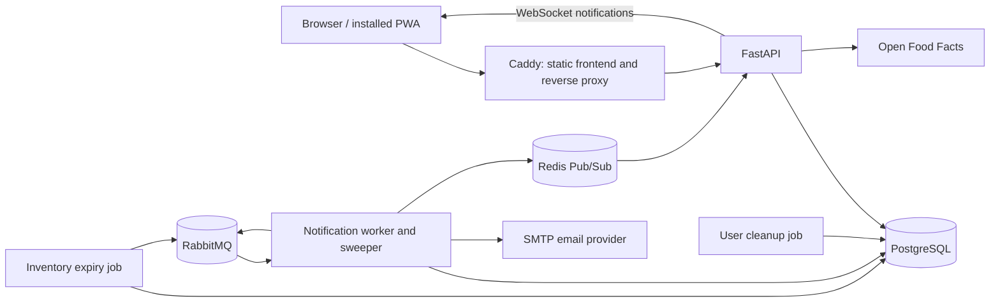

# Application architecture

This document describes the implementation in this repository. It is an overview of current behavior, not a list of proposed requirements. See [AGENTS.md](../AGENTS.md) for contributor instructions.

## System overview

Family Inventory is a FastAPI application with a React/TypeScript frontend. PostgreSQL stores application data. Separate worker and scheduled-job processes handle notifications and maintenance. Docker Compose runs the production services.



PostgreSQL is the durable source of application and notification state. RabbitMQ transports background events. Redis Pub/Sub distributes live notification updates; it does not replace the database-backed inbox.

## Backend request flow

[app/main.py](../app/main.py) registers domain routers under `/api/v1` and configures application lifespan, CORS, and exception handlers.

A typical request follows:

```text
Frontend API call
  → FastAPI router and request validation
  → Authentication and authorization
  → Service logic
  → Repository queries through an async SQLAlchemy session
  → PostgreSQL
```

Domain packages live under `app/apis/`. This layering is a convention rather than a strict boundary: some routes, including home settings, directly coordinate database work. Household category endpoints are exposed through the homes routers rather than a separate category router.

Pydantic schemas define request and response contracts. Domain exceptions are translated to HTTP responses by [exception_handlers.py](../app/core/exception_handlers.py). [session.py](../app/core/database/session.py) manages the async connection pool and session cleanup; transaction boundaries are established by callers rather than automatically committed by the session dependency.

## Data and domain boundaries

| Domain | Responsibility and relationships |
| --- | --- |
| Users | Accounts, activation, login, and password recovery. |
| Homes and memberships | Homes group inventory and users. Membership records associate users with home roles. |
| Household categories | Categories belong to one home; `(home_id, name)` identifies a unique category name within that home. |
| Products | Shared product catalog, including names and barcodes. Products can be referenced by inventory in multiple homes. |
| Inventory | Each item belongs to a home and references a product and household category. Stores quantity, unit, expiry date, and notes. |
| Notifications | Subscriptions, events, delivery records, account-event outbox, and persistent in-app inbox. |

An inventory item's name comes from its product. Multiple inventory rows can reference the same product. Product and category foreign keys use `RESTRICT`, so deleting a referenced record cannot silently remove inventory. Services validate category ownership for the selected home; the category foreign key alone does not establish that both records belong to the same home.

Home settings cover the home name, memberships, and category management. Managing settings/categories requires membership in that home and either the owner role or global admin status. Global admin status alone does not satisfy this membership requirement. Other operations apply their own permission checks.

Source: [inventory models](../app/apis/inventory/models.py), [home settings](../app/apis/homes/settings.py), and [category service](../app/apis/household_categories/service.py).

## Authentication and account recovery

HTTP authentication uses bearer JWTs. [get_current_user](../app/iam/dependencies.py) validates the token, loads the user, and rejects missing or inactive accounts. Home authorization is a separate check from authentication.

Activation and password-reset flows use background email delivery. Their detailed behavior is documented in [activation recovery](activation-recovery.md) and [password reset](password-reset.md).

WebSocket authentication uses [websocket_auth.py](../app/iam/websocket_auth.py), supporting a bearer header or token query parameter. Tokens in URLs must be treated as credentials and excluded from logs.

## Product lookup

[ProductLookupService](../app/apis/product/service.py) checks the local catalog by barcode first. If no local product exists and the external provider is enabled, it queries Open Food Facts through the catalog client abstraction.

The response distinguishes `local`, `external`, `not_found`, and `provider_unavailable`. An external result is a candidate, not an automatically persisted product. Provider failure is represented separately from a missing product so manual product creation can remain available.

## Notifications and background work

Two producer paths feed RabbitMQ:

1. Account email requests use the notification outbox in PostgreSQL. The worker's sweeper publishes pending outbox events and tracks retries.
2. The inventory expiry job creates/tracks expiry alerts in PostgreSQL, publishes pending alerts to RabbitMQ, and records publication results. This path uses inventory alert records rather than the account-event outbox.

The notification consumer ingests events and creates delivery tasks. Inventory recipients are resolved from enabled subscriptions; account email events resolve the account recipient. Channel senders deliver email or persist in-app notifications. The consumer includes retry and dead-letter handling, and the sweeper processes pending delivery/outbox work. Database uniqueness and conflict handling provide deduplication at specific steps; this is not a guarantee of exactly-once external delivery.

After an in-app notification is stored, the sender attempts a Redis publication. The API's `/api/v1/notifications/ws` and `/api/v1/notifications/ws/inbox` routes subscribe to the authenticated user's channel and forward events to the browser. Live delivery is best-effort: the persistent inbox remains available through HTTP when a connection misses an event.

Source: [worker entry point](../app/apis/notifications/worker/__main__.py), [consumer](../app/apis/notifications/worker/consumer.py), [sweeper](../app/apis/notifications/worker/sweeper.py), [channel senders](../app/apis/notifications/worker/channels.py), [notification router](../app/apis/notifications/router.py), and [expiry job](../app/jobs/inventory_expiry_job.py).

## Frontend and PWA

The web client lives in `frontend/` and uses React, TypeScript, and Vite. API helpers live under `frontend/src/api/`. During development, Vite proxies `/api/v1` requests, including WebSockets, to the local backend.

[vite.config.mjs](../frontend/vite.config.mjs) configures `vite-plugin-pwa`, the web app manifest, icons, and service-worker generation. The service worker precaches frontend assets and excludes API paths from navigation fallback. No API runtime caching is configured. Installing the PWA does not provide offline inventory editing or synchronization; backend-dependent actions still need connectivity.

Production Caddy serves frontend assets and falls back to `index.html` for SPA routes. It proxies `/api/*`, `/health`, and API documentation paths to FastAPI. See [Caddyfile](../deploy/Caddyfile).

## Deployment and migrations

The [deployment workflow](../.github/workflows/deployment.yml) requires successful `tests` and `Code Quality` push runs for the same main-branch commit. It builds backend/frontend images tagged with the commit SHA, pushes them to GHCR, and transfers deployment files to the server over SSH.

[release.sh](../deploy/release.sh) performs the release sequence:

1. Load server-managed environment files and pull images.
2. Start PostgreSQL, RabbitMQ, and Redis and wait for infrastructure health.
3. Create a PostgreSQL dump and verify that its archive listing is readable.
4. Start the application stack. The one-shot `migrate` service runs `alembic upgrade head`; API, worker, expiry, and cleanup services depend on its successful completion.
5. Wait for configured service health checks, then check the public API health response and frontend URL.
6. Persist the successful image tag and update the current-release pointer.

A failure preserves the previous release pointer but does not automatically restore the database or revert containers already changed. Migrations alter the shared database; older application containers may still be running while migrations execute. Migration compatibility therefore matters during deployment. The dump listing check is not a restore test, and `/health` returns a basic status response rather than validating every dependency or background process.

Production composition is defined in [docker-compose.prod.yml](../deploy/docker-compose.prod.yml) and its infrastructure, application, and frontend Compose files. See [automatic deployment](automatic-deployment.md) and [deployment operations](deployment.md) for procedures.

## Resource lifecycle and tests

FastAPI lifespan connects the RabbitMQ publisher, initializes Redis, and closes these resources and the lazy product catalog client on shutdown. Both `app.state` resources and lazy module-level clients are used in the current implementation.

The HTTPX `ASGITransport` fixture in [tests/conftest.py](../tests/conftest.py) does not automatically execute application lifespan. Tests must provide required resources and cleanup explicitly, or arrange to run lifespan. Backend tests use PostgreSQL; frontend production builds provide a separate compilation check.

Configuration is centralized under `app/core/configs/`. Server environment files remain outside release archives; new required configuration values need to be provisioned as part of operational rollout.
